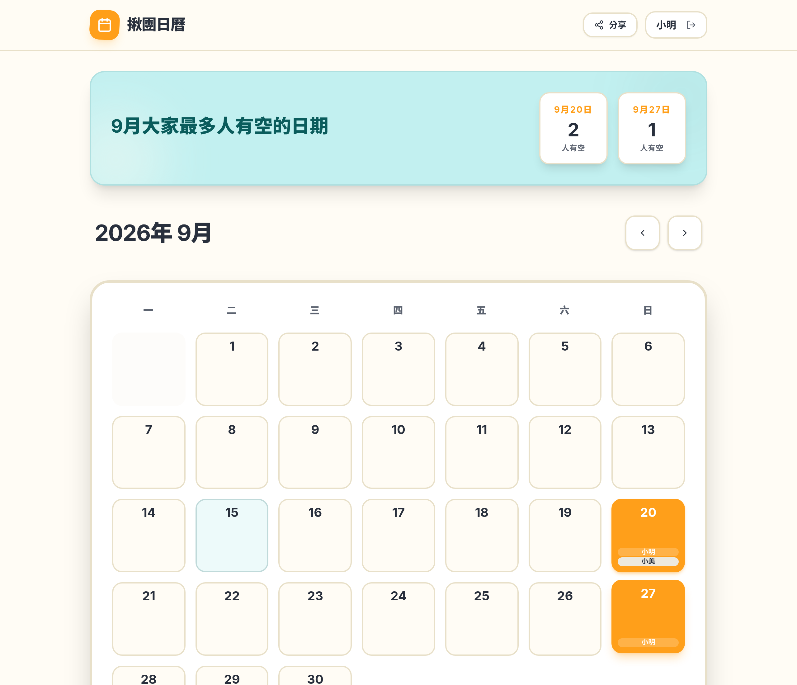
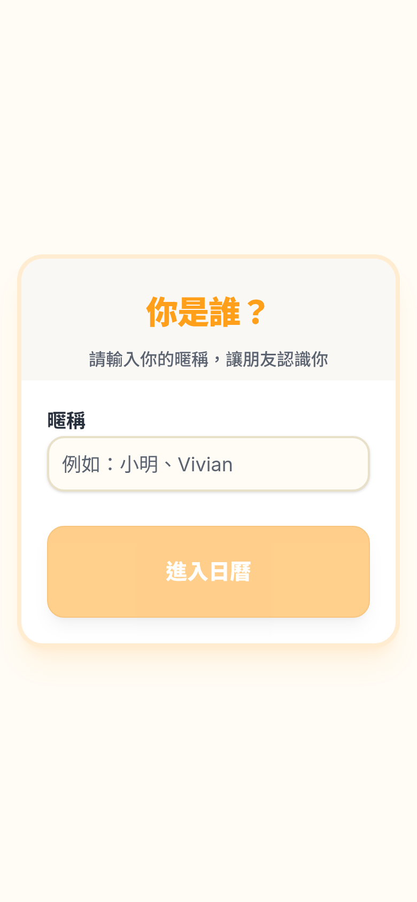
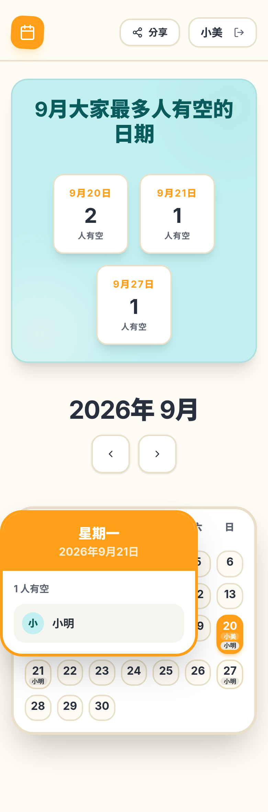

# 朋友揪團日曆

共用可用日期規劃 app，讓朋友輕鬆標示有空的日期。無需登入，打開網頁就能用。

**線上使用：** [https://ergeargwer.github.io/group-calendar/](https://ergeargwer.github.io/group-calendar/)

把這個網址傳給朋友即可一起填。點日期切換自己有沒有空，日曆會自動同步。

## 畫面擷取

### 輸入暱稱

第一次進入時輸入暱稱，之後會記在這台裝置上。


### 共用日曆

格子上會顯示誰有空；上方摘要會排出這個月最多人有空的日期。點右上角「分享」可複製連結。



### 手機

同一個網址在手機上也能填。點有人的日期，會跳出名單。

| 輸入暱稱 | 日曆與名單 |
| --- | --- |
|  |  |

## 怎麼用

- 第一次進入時輸入暱稱
- 點日期標示／取消有空
- 右上角「分享」複製連結給朋友
- 若要另開一團，在網址加上 `?g=團名`，例如  
  `https://ergeargwer.github.io/group-calendar/?g=weekend`

## 本機開發

需要 Node.js 22 與 [pnpm](https://pnpm.io/)。

```bash
pnpm install
cd artifacts/group-calendar
PORT=5173 BASE_PATH=/ pnpm dev
```

瀏覽器開啟 http://localhost:5173/

## 技術說明

前端是 React + Vite 靜態網站，由 GitHub Actions 建置並發佈到 GitHub Pages。

執行時不再需要 Express 或 PostgreSQL。資料會立刻存在瀏覽器，並同步到共用日曆；朋友打開同一個網址就能看到彼此標示的日期。

## 開發紀錄

### 2026-04-27　專案起步（Replit）

- 建立 GitHub 倉庫
- 在 Replit 做出完整的「朋友揪團日曆」
- 當時架構：React + Vite 前端、Express API、PostgreSQL + Drizzle
- 功能：暱稱、月份日曆、點選有空、最佳日期摘要；不需登入

### 2026-09-15　改成可在 GitHub 上直接使用

原先一定要跑 Replit 後端和資料庫，GitHub 上只能看原始碼、不能直接用。這次改成：

- 拿掉執行期對 Express、PostgreSQL 的依賴，改成靜態前端
- 資料存在瀏覽器，並同步到共用日曆
- 用 GitHub Actions 自動建置，發佈到 GitHub Pages
- 加上「分享」複製連結，以及 `?g=團名` 開新團
- 遠端同步加上逾時；頁面先顯示本機內容，避免一直停在空白載入畫面

線上地址：https://ergeargwer.github.io/group-calendar/
